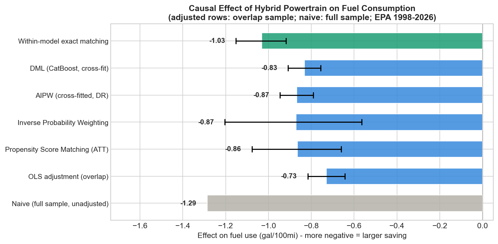

# Causal Effect of Hybrid Powertrain on Fuel Consumption

Estimating, from observational EPA data (~50k vehicles, model years 1984-2027), how
much fuel a hybrid powertrain actually saves once you account for the fact that
hybrids are not random - they cluster in specific segments, engine sizes, brands, and
model years. The project applies and cross-checks ten causal-inference estimators
plus a full robustness suite.

## TL;DR

- A naive comparison says hybrids get **+8.8 MPG (+42%)**. That is the *MPG illusion*:
  MPG is the reciprocal of consumption, so gaps at the high end are exaggerated.
- Measured correctly (gallons per 100 miles) and adjusted for confounders, comparable
  hybrids use **~0.83-0.87 fewer gal/100mi, about 17-19% less fuel** -
  roughly **125 gal and 1.1 t CO2 saved per year** at 15k mi/yr.
- IPW, AIPW, DML, DoubleML IRM, PSM and overlap weights all land in that range;
  within-model twins give -1.03. Placebo, random-common-cause and subset checks pass,
  and an unmeasured confounder would need RR ~3.2 with both treatment and outcome to
  explain the effect away. The negative-control outcome does not pass (see Caveats).



## Results

Effect on fuel use, gal/100mi. Each % is relative to E[Y(0)] of that row's target
population.

| Estimator | Estimand | Effect | % fuel | 95% CI |
|---|---|---|---|---|
| Naive (unadjusted, full sample) | - | -1.29 | -26% | - |
| OLS adjustment | variance-weighted | -0.73 | -16% | [-0.82, -0.64] |
| Propensity score matching | ATT | -0.86 | -19% | [-1.08, -0.66] |
| Inverse probability weighting | overlap ATE | -0.87 | -18% | [-1.20, -0.56] |
| AIPW (cross-fitted, doubly robust) | overlap ATE | -0.87 | -18% | [-0.95, -0.79] |
| Double ML (partial linear, CatBoost) | variance-weighted | -0.83 | -18% | [-0.91, -0.76] |
| Within-model twins (Camry vs Camry Hybrid) | ATT | -1.03 | -25% | [-1.15, -0.92] |
| Mahalanobis + PS caliper matching | ATT | -0.71 | -16% | [-0.81, -0.59] |
| Overlap weights | ATO | -0.86 | -19% | [-1.05, -0.66] |
| DoubleML IRM (library) | overlap ATE | -0.85 | -17% | [-0.93, -0.76] |
| EconML causal forest | overlap ATE | -0.98 | -20% | [-1.02, -0.94]* |

\* Row-level CI, not cluster-robust, so too narrow. Variance-weighted means weights
e(1-e), close to the ATO.

## Method

Treatment is a hybrid (non-plug-in HEV) powertrain vs pure gasoline. Confounders:
engine displacement, cylinders, model year, forced induction (turbo/supercharger),
size class, drive type, manufacturer. Post-treatment variables (CO2, fuel cost, power)
are deliberately excluded.

Estimators: naive difference, OLS regression adjustment, propensity-score matching,
IPW (Hajek), AIPW, Double ML, within-model exact matching, Mahalanobis matching
within a PS caliper, overlap weights (ATO),
DoubleML IRM, EconML causal forest. Heterogeneous effects come from a cross-fitted
T-learner.

What makes the estimates trustworthy:

- **Right outcome scale** - gallons/100mi, not MPG (Larrick & Soll 2008).
- **Clustered uncertainty** - observations de-duplicated and inference clustered by
  nameplate (the same car recurs across trims/years and is not independent). Every
  CI except the causal forest's is cluster-robust.
- **No leakage** - the propensity score and every nuisance model are cross-fitted with
  GroupKFold grouped by nameplate, so replicate trims never straddle folds.
- **Explicit estimand** - hybrids and gasoline vehicles overlap only in part of the
  covariate space, so the target is the effect on the overlap (common-support)
  population; matching rows target the ATT. A whole-fleet ATE is not identified.
- **Falsification** - placebo treatment (effect vanishes), random common cause (no
  change), data-subset stability. The negative-control outcome fails (see Caveats).
- **Sensitivity** - Rosenbaum bounds (per-nameplate; significant up to Gamma = 10, the
  largest tested) and an E-value of ~3.2.

## Repository

```
hybrid_causal_inference.py      analysis source (jupytext percent format)
hybrid_causal_inference.ipynb   executed notebook with outputs and figures
vehicles.csv                    EPA Fuel Economy snapshot (see Data provenance)
01..07_*.png                    generated figures
requirements.txt
```

## Reproduce

```bash
pip install -r requirements.txt
python hybrid_causal_inference.py          # runs everything, writes the .png figures
# regenerate the executed notebook from source:
jupytext --to notebook --execute hybrid_causal_inference.py -o hybrid_causal_inference.ipynb
```

Runtime is about 1-2 minutes on a laptop. All randomness is seeded, so results reproduce.

## Data provenance

- **Source**: US EPA / DOE Fuel Economy dataset, `fueleconomy.gov/feg/epadata/vehicles.csv`.
- **Snapshot**: downloaded 2026-07-02 (server `last-modified` 2026-06-16),
  49,995 rows, model years 1984-2027. MD5 `1d4a8e48f98e7f3c685e4d77e585f0b9`.
  The CSV is committed so the analysis is fully reproducible against a frozen file.
- **Analysis window**: MY1998-2026. MY2027 rows are early-certified upcoming models
  (that year is incomplete), so they are dropped.
- **Control purity**: `atvType` is NaN not only for gasoline cars but also for diesels
  and CNG vehicles, so the control group is defined by `fuelType1` (gasoline), not by
  `atvType` alone.

## Caveats

- Observational data: identification rests on no-unmeasured-confounding within the
  overlap region. The sensitivity analyses bound, but cannot eliminate, this risk.
- The outcome is EPA *rated* fuel economy. Real-world hybrid advantage is somewhat
  smaller because EPA test cycles favor hybrids (Consumer Reports); the code shows an
  illustrative rated-vs-real-world bracket.
- **Mixed treatment**: EPA's "Hybrid" flag also covers 48V mild hybrids (e.g. BMW
  M440i, Land Rover MHEV, Ram eTorque); 43% of hybrid rows are tagged "Mild Hybrid" in
  `eng_dscr`. They save far less fuel and dilute the estimate - part of why the effect
  is smaller here than on an older MY2015 snapshot (~-1.1 to -1.2). Splitting full vs
  mild HEVs is left as future work.
- **Negative control fails**: hybrids show +1.5 cu ft passenger volume (z = 3.5;
  0.18 SD vs 0.70 SD for the main effect). Residual body/packaging confounding is
  possible. EPA car classes are defined by interior volume, so this control is weak.
- **Within-model twins** must match on nameplate, drive, model year and forced
  induction, so only 373 hybrids from 53 nameplates have one. That estimate covers
  hybrids with a gasoline twin, and its bootstrap CI treats each twin as fixed.
- No sales weighting: a rare trim counts the same as a bestseller.

## Future work

- Separate full HEVs from mild hybrids (via `eng_dscr` / `evMotor`).
- Join sales/registration weights (sales-weighted estimand), curb weight and MSRP
  (stronger selection confounders), and real-world fuel economy (rated -> real outcome).

## References

- Larrick & Soll (2008), "The MPG Illusion", *Science*.
- Li, Morgan & Zaslavsky (2018), "Balancing Covariates via Propensity Score
  Weighting", *JASA* (overlap weights).
- Chernozhukov et al. (2018), "Double/Debiased Machine Learning".
- VanderWeele & Ding (2017), E-value sensitivity analysis.
- Data: US EPA / DOE Fuel Economy dataset, fueleconomy.gov.

## License

MIT - see [LICENSE](LICENSE).
