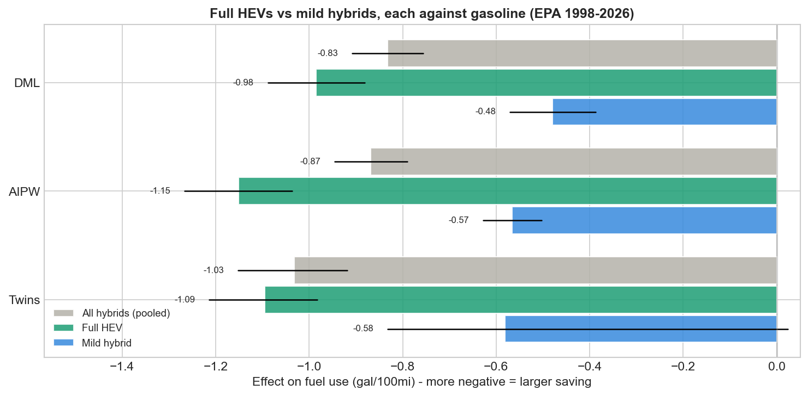

# Causal Effect of Hybrid Powertrain on Fuel Consumption

Estimating, from observational EPA data (~50k vehicles, model years 1984-2027), how
much fuel a hybrid powertrain actually saves once you account for the fact that
hybrids are not random - they cluster in specific segments, engine sizes, brands, and
model years. The project applies and cross-checks ten causal-inference estimators
plus a full robustness suite.

## TL;DR

- A naive comparison says hybrids get **+8.8 MPG (+42%)**. That is the *MPG illusion*:
  MPG is the reciprocal of consumption, so gaps at the high end are exaggerated.
- Measured correctly (gallons per 100 miles) and adjusted for confounders, comparable
  hybrids use **~0.83-0.87 fewer gal/100mi, about 17-19% less fuel** -
  roughly **125 gal and 1.1 t CO2 saved per year** at 15k mi/yr.
- IPW, AIPW, DML, DoubleML IRM, PSM and overlap weights all land in that range;
  within-model twins give -1.03. Placebo, random-common-cause and subset checks pass,
  and an unmeasured confounder would need RR ~3.2 with both treatment and outcome to
  explain the effect away. The negative-control outcome does not pass (see Caveats).
- EPA's "Hybrid" flag mixes two products. Split apart, **full HEVs use 23-25% less
  fuel** (DML -0.98 to -1.03, AIPW -1.11 to -1.16 gal/100mi over five seeds;
  within-model twins -1.09, -27%), while **mild hybrids (mostly 48V) save 9-13%**
  (-0.44 to -0.65). The pooled ~18% is a blend.


## Results

Effect on fuel use, gal/100mi. Each % is relative to E[Y(0)] of that row's target
population.

| Estimator | Estimand | Effect | % fuel | 95% CI |
|---|---|---|---|---|
| Naive (unadjusted, full sample) | - | -1.29 | -26% | - |
| OLS adjustment | variance-weighted | -0.73 | -16% | [-0.82, -0.64] |
| Propensity score matching | ATT | -0.86 | -19% | [-1.08, -0.66] |
| Inverse probability weighting | overlap ATE | -0.87 | -18% | [-1.20, -0.56] |
| AIPW (cross-fitted, doubly robust) | overlap ATE | -0.87 | -18% | [-0.95, -0.79] |
| Double ML (partial linear, CatBoost) | variance-weighted | -0.83 | -18% | [-0.91, -0.76] |
| Within-model twins (Camry vs Camry Hybrid) | ATT | -1.03 | -25% | [-1.15, -0.92] |
| Mahalanobis + PS caliper matching | ATT | -0.71 | -16% | [-0.81, -0.59] |
| Overlap weights | ATO | -0.86 | -19% | [-1.05, -0.66] |
| DoubleML IRM (library) | overlap ATE | -0.85 | -17% | [-0.93, -0.76] |
| EconML causal forest | overlap ATE | -0.98 | -20% | [-1.02, -0.94]* |

\* Row-level CI, not cluster-robust, so too narrow. Variance-weighted means weights
e(1-e), close to the ATO.

### Full vs mild hybrids

Each type against gasoline on its own PS and common support, so the gasoline sets
differ. Effect and CI from seed 42; the seed range over five seeds also reflects the
seed-dependent common support. Mild-hybrid twins are not significant on their own.

| Type | Estimator | Estimand | Hybrids in overlap | Effect | % fuel | 95% CI | Seed range |
|---|---|---|---|---|---|---|---|
| Full HEV | DML | variance-weighted | 955 | -0.98 | -23% | [-1.09, -0.88] | -1.03 to -0.98 |
| | AIPW | overlap ATE | 955 | -1.15 | -23% | [-1.27, -1.04] | -1.16 to -1.11 |
| | Twins, 44 nameplates | ATT | 327 pairs | -1.09 | -27% | [-1.21, -0.98] | - |
| Mild hybrid | DML | variance-weighted | 801 | -0.48 | -10% | [-0.57, -0.39] | -0.53 to -0.44 |
| | AIPW | overlap ATE | 801 | -0.57 | -11% | [-0.63, -0.50] | -0.65 to -0.55 |
| | Twins, 10 nameplates | ATT | 46 pairs | -0.58 | -11% | [-0.83, +0.02] | - |

Sensitivity of the full-HEV estimate:
- Twins Rosenbaum bound: significant at Gamma = 10 (p = 0.03), not at 15.
- DoubleML omitted-variable bounds: RV 34%, RVa 31%. At rho = 1, confounders as
  strong as displacement or model year (given the other covariates) leave 95%
  bounds of [-1.46, -0.51] and [-1.57, -0.39]; one as strong as the whole engine
  block has no finite bound.
- PS trims from 0.01 to 0.1, each a different population: DML -0.98 to -1.00, AIPW
  -0.94 to -1.17.
- Dropping the 68 older assist-system rows (Honda/Acura IMA, Mercedes S400/E400,
  BMW ActiveHybrid 7): DML -1.03, within the seed range.



## Method

Treatment is a hybrid (non-plug-in HEV) powertrain vs pure gasoline. Confounders:
engine displacement, cylinders, model year, forced induction (turbo/supercharger),
size class, drive type, manufacturer. Post-treatment variables (CO2, fuel cost, power)
are deliberately excluded.

Estimators: naive difference, OLS regression adjustment, propensity-score matching,
IPW (Hajek), AIPW, Double ML, within-model exact matching, Mahalanobis matching
within a PS caliper, overlap weights (ATO),
DoubleML IRM, EconML causal forest. Heterogeneous effects come from a cross-fitted
T-learner.

What makes the estimates trustworthy:

- **Right outcome scale** - gallons/100mi, not MPG (Larrick & Soll 2008).
- **Clustered uncertainty** - observations de-duplicated and inference clustered by
  nameplate (the same car recurs across trims/years and is not independent). Every
  CI except the causal forest's is cluster-robust.
- **No leakage** - the propensity score and every nuisance model are cross-fitted with
  GroupKFold grouped by nameplate, so replicate trims never straddle folds.
- **Explicit estimand** - hybrids and gasoline vehicles overlap only in part of the
  covariate space, so the target is the effect on the overlap (common-support)
  population; matching rows target the ATT. A whole-fleet ATE is not identified.
- **Falsification** - placebo treatment (effect vanishes), random common cause (no
  change), data-subset stability. The negative-control outcome fails (see Caveats).
- **Sensitivity** - Rosenbaum bounds (per-nameplate; significant at Gamma = 10, not
  at 15) and an E-value of ~3.2. For the full-HEV estimate also DoubleML
  omitted-variable bounds benchmarked against observed covariates, and a
  PS-trimming check.

## Repository

```
hybrid_causal_inference.py      analysis source (jupytext percent format)
hybrid_causal_inference.ipynb   executed notebook with outputs and figures
vehicles.csv                    EPA Fuel Economy snapshot
DATASET.md                      data source, fields, treatment/control definitions
01..08_*.png                    generated figures
requirements.txt
```

## Reproduce

```bash
pip install -r requirements.txt
python hybrid_causal_inference.py          # runs everything, writes the .png figures
# regenerate the executed notebook from source:
jupytext --to notebook --execute hybrid_causal_inference.py -o hybrid_causal_inference.ipynb
```

Runtime is about 4 minutes on a laptop. All randomness is seeded, so results reproduce.

## Data provenance

US EPA / DOE Fuel Economy dataset, `fueleconomy.gov/feg/epadata/vehicles.csv`,
downloaded 2026-07-02 (49,995 rows, model years 1984-2027, MD5
`1d4a8e48f98e7f3c685e4d77e585f0b9`). The CSV is committed so the analysis runs against
a frozen file. Analysis window is MY1998-2026; MY2027 rows are incomplete early
certifications. Fields, treatment/control definitions, exclusions and data checks are in
[DATASET.md](DATASET.md).

## Caveats

- Observational data: identification rests on no-unmeasured-confounding within the
  overlap region. The sensitivity analyses bound, but cannot eliminate, this risk.
- The outcome is EPA *rated* fuel economy. Real-world hybrid advantage is somewhat
  smaller because EPA test cycles favor hybrids (Consumer Reports); the code shows an
  illustrative rated-vs-real-world bracket.
- **Mixed treatment**: EPA's "Hybrid" flag also covers mild hybrids, mostly 48V (e.g. BMW
  M440i, Land Rover MHEV, Ram eTorque); 43% of hybrid rows are tagged "Mild Hybrid" in
  `eng_dscr`. The pooled estimates average two products; see the full vs mild split.
  The split rule is in [DATASET.md](DATASET.md). Older assist systems with 60-160V
  packs (Honda IMA, Mercedes S400/E400, BMW ActiveHybrid 7) count as full HEVs.
- **Negative control fails**: hybrids show +1.5 cu ft passenger volume (z = 3.5;
  0.18 SD vs 0.70 SD for the main effect). Residual body/packaging confounding is
  possible. EPA car classes are defined by interior volume, so this control is weak.
  It fails for full HEVs (+1.8 cu ft, z = 2.7) and is uninformative for mild ones
  (+0.06, SE 0.80). Adding passenger volume to X moves the full-HEV estimate from
  -0.90 to -0.94 on that subsample (away from zero). Within-model twins hold the
  nameplate fixed, which removes most body differences.
- **Within-model twins** must match on nameplate, drive, model year and forced
  induction, so only 373 hybrids from 53 nameplates have one. That estimate covers
  hybrids with a gasoline twin, and its bootstrap CI treats each twin as fixed.
- No sales weighting: a rare trim counts the same as a bestseller.

## Future work

- Join sales/registration weights (sales-weighted estimand), curb weight and MSRP
  (stronger selection confounders), and real-world fuel economy (rated -> real outcome).

## References

- Larrick & Soll (2008), "The MPG Illusion", *Science*.
- Li, Morgan & Zaslavsky (2018), "Balancing Covariates via Propensity Score
  Weighting", *JASA* (overlap weights).
- Chernozhukov et al. (2018), "Double/Debiased Machine Learning".
- Chernozhukov, Cinelli, Newey, Sharma & Syrgkanis (2022), "Long Story Short:
  Omitted Variable Bias in Causal Machine Learning" (RV, benchmarks).
- VanderWeele & Ding (2017), E-value sensitivity analysis.
- Data: US EPA / DOE Fuel Economy dataset, fueleconomy.gov.

## License

MIT - see [LICENSE](LICENSE).
